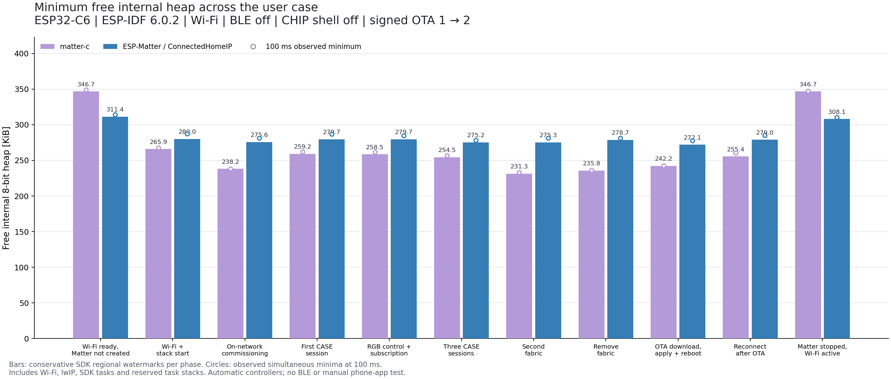
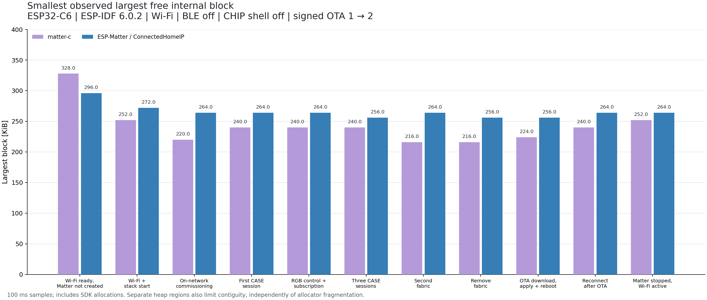

# Memory43 — same-IDF user case, including real OTA

2026-10-24. Two physical ESP32-C6-DevKitM-1 boards, 4 MiB flash, no PSRAM.
COM23: matter-c; COM24: ESP-Matter/ConnectedHomeIP. Wi-Fi through the same lab AP,
Windows IPv6 link-local controllers, UART1000000. Optimization remains closed;
the new native OTA functionality is described in [Memory42](memory42-validation.md).

## Result and application budget

The conservative phase minimum across this workload is **236844 B /231.3 KiB**
for matter-c and **278588 B /272.1 KiB** for the optimized reference. Reference
headroom is **41744 B /40.8 KiB** larger. The worst C phase is adding the second
fabric; the reference minimum occurs during OTA. At 100 ms sampling, the
corresponding observed minima are **238756 B /233.2 KiB** and
**284632 B /278.0 KiB**. SDK regional watermarks are conservative and are not an
exact simultaneous minimum; the chart shows the sampled measurement as circles.

After deletion, at65 seconds with Wi-Fi still connected, current free heap is
**357620 B /349.2 KiB** for C versus **317612 B /310.2 KiB** for CHIP, giving C
**40008 B /39.1 KiB** more. The largest blocks are **258048 B /252 KiB** versus
**270336 B /264 KiB**: more total free bytes does not imply a larger contiguous
allocation. Before creating Matter, the current values are **357332 B** versus
**321684 B**. Linked static pools and application/SDK configuration still matter
when no instance exists.

Thus C's explicit lifetime is useful for running another service while Matter is
absent. Under the measured active workload the optimized reference has more free
RAM. These are application budgets in the complete firmware, not isolated
library allocation totals. No MQTT/HTTP/TLS client or server was started in this
run; connection counts, certificate chains and request buffers must be measured
before promising that a particular additional service fits.

All values below are bytes, conservative SDK phase minimum. Complete sampled,
current, largest-block and task data: [JSON](memory43/results.json),
[CSV](memory43/results.csv).

| Measurement case | matter-c | ESP-Matter / CHIP |
|---|---:|---:|
| Wi-Fi ready, Matter not created | 355068 | 318856 |
| Wi-Fi and stack startup | 272276 | 286720 |
| On-network commissioning | 243896 | 282248 |
| First CASE session | 265440 | 286412 |
| RGB control and subscription | 264664 | 286388 |
| Three CASE sessions | 260568 | 281856 |
| Second fabric | 236844 | 281948 |
| Remove second fabric | 241464 | 285372 |
| OTA download, Apply and reboot | 248028 | 278588 |
| Reconnect after OTA | 261572 | 285720 |
| Matter stopped, Wi-Fi active | 355048 | 315504 |

## Matched SDK and remaining differences

Both run **ESP-IDF6.0.2**, commit
`7101770dc6db2667b3c477cc31365dd1acd6db4e`, with mDNS1.14.0. Reference:
ESP-Matter release/v1.6.1 `4c9dd7aa80b3ddfa64c814bdfabe76c60944cc75`,
ConnectedHomeIP `b1902b39ac6734913ce5f4d2abf153693a50264b`.
All three upstream checkouts were clean on final inspection. The15 changed
native production C/header files match the VM's build inputs after LF
normalization, recorded against commit `0851c47` in [source.json](memory43/source.json).
Build profiles,
unsigned/signed image hashes and ELF hashes are retained in
[builds.json](memory43/builds.json); the exact initial configs are
[C](memory43/profiles/c-sdkconfig) and
[reference](memory43/profiles/reference-sdkconfig). Version2 changes the numeric
project/software version to2. Build/signing keys and Wi-Fi credentials are absent
from these exports.

Both select compiler size optimization, Wi-Fi TX/RX/extra IRAM options off,
ROM SPI flash implementation, BLE off, warning-level logs, UART1M, dual OTA
partitions, SDK rollback and software signature validation. ISR/heap routines
retain their original IRAM placement. Reference CHIP shell is **off**, and
device-type/dynamic-endpoint capacities are both2. This follows the applicable
[Espressif RAM guidance](https://docs.espressif.com/projects/esp-matter/en/latest/esp32c6/optimizations.html)
without substituting its published C3/other-IDF example numbers for C6 results.

This is the same user workload, not identical implementations or every optional
feature. The established lab models differ (C RGB versus the reference light
with HS added, retaining other reference features). Existing protocol/fabric,
session, exchange and subscription ceilings were preserved rather than reduced
to the current workload. Reference persistent subscriptions remain enabled.
C retains its software ECC backend configuration; reference retains hardware ECC.
The C owner task requests12288 B and its observed reservation is12800 B.
Reference requests main3584 B plus CHIP8192 B, in addition to SDK task overhead.
No task-stack trimming or core memory optimization was performed for this test.

Signed C version2 ESP payload: **1183744 B**; reference: **1380352 B**. Outer
Matter headers add84 B each. OTA phase duration in the final runs is170.6s /52.4s,
respectively, including Apply/restart/notification. Different image sizes and
application scheduling remain; this is not a matched throughput benchmark.

## Common physical workload and checks

Both boards begin uncommissioned on the same externally provisioned Wi-Fi.
No BLE is needed. The automated peer is pinned Matter.js0.17.9 with the explicit
corrected exchange-role helper already used by Memory26/27; its source hash and
profile are exported in the retained private run results. No installed dependency
is patched. Physical use of chip-tool was optional; the VM's controller has no
direct route to this link-local WLAN, so the Windows automated controller was
used for both boards.

1. Wait for real firmware READY, commission on-network via PASE, establish CASE,
   read software version1 and one committed fabric.
2. Subscribe to OnOff/CurrentLevel/CurrentHue, invoke On/Level/HS and check RGB
   readback and received updates.
3. Establish two more independent CASE sessions under the first controller's
   fabric/NodeId, with one three-path subscription per session. These are three
   **session equivalents**, not three distinct phone certificates.
4. Commission a separate controller/fabric, control and subscribe, then remove
   that fabric while active. Require a successful response and a surviving
   primary fabric. Drain sessions for12s without changing protocol timers.
5. Configure the default OTA provider. Transfer a real signed Matter/ESP image,
   validate Apply token/version, install into the inactive partition, reboot,
   confirm the running image and require NotifyUpdateApplied for version2 with
   the matching token. Original fabric remains; no re-commissioning shortcut.
6. Open fresh CASE after restart, read version2/fabric count, subscribe again,
   exercise RGB, turn off and drain.
7. Delete Matter through each app's lifecycle, observe65s and require external
   IPv6 ping3/3 with Wi-Fi still active. The reference observer joins its CHIP
   task before releasing platform queues, as established in Memory41.

Both full runs pass: **28 reads,23 invokes,5 subscriptions,1 Apply,1 Notify**,
version1→2, zero unexpected subscription closures and zero SDK allocation
failures. C performs3 bounded client Busy retries when requests overlap its
preserved two-Read limit; reference needs0. Reports38 /20 are not required equal:
report scheduling and state coalescing differ. All intended Hue values/readbacks
are checked. C ends with zero tracked core allocations/bytes.

The reference needs a small application-side call to the SDK's trial confirmation
after startup. The pinned requestor's version check alone does not mark an ESP
pending image valid. This glue is in the copied application; upstream CHIP/SDK
source is unchanged. Its OTA and shutdown paths are real, not simulated.

## Heap, fragmentation and stack interpretation

The observer is shared between both images. A100ms SDK timer samples
`MALLOC_CAP_INTERNAL|MALLOC_CAP_8BIT`, current free, largest free block and block
counts. SDK local minima reset at phase boundaries; pre-reboot shutdown records
and post-reboot startup are included in the OTA phase. Regional SDK minima can
occur at different instants; sampling can miss shorter peaks. Static linked RAM
reduces the available heap pool before measurement starts.

This includes Wi-Fi, lwIP, SDK services, NVS, crypto, app allocations and reserved
heap-backed task stacks. Do **not** add used task stack bytes to the heap cost
again. Stack high-water sampling covers known task names, including main/CHIP,
Wi-Fi, timers and TCP/IP; it is not proof of maximum ISR stack use or every task.
Observed minimum unused bytes: C main8872, reference main1960 and CHIP2520.
No stack overflow, watchdog reset or healthy SDK OOM occurred. Core/adapter OOM
and crash ordering were checked separately under the native/boundary campaigns
in [Memory42](memory42-validation.md).

The common phase/task reporter adds no heap allocation of its own. Its timer,
console transport and state are included in the image. Older task-inventory
helpers still make small temporary allocations at startup/teardown and are
included as well. The benchmark does not subtract observer overhead.
The ratio largest/free is not a pure fragmentation percentage: separate heap
regions and persistent SDK allocations also constrain contiguous blocks.

Reference `Shutdown()` requires application-specific joining and handler cleanup;
it can preserve Wi-Fi as demonstrated here, but linked singleton/static pools
remain. This one-way observer does not establish a supported production
stop/restart API. C's application-owned new/delete model is simpler to compose;
this run does not establish repeated recreation of either stack.

## Reproduction, scope and remaining work

Public preparation, collector/controller and plot commands are in the
[reference README](../../examples/esp-matter-memory/README.md#same-idf-user-case-with-real-ota).
Artifacts are built on the isolated VM with at most4 Ninja jobs; private signing,
NVS provisioning, flash and UART run on Windows. No shared SDK, VM key or other
chat's build was changed. Public numeric exports omit raw UART, network identity,
controller fabric keys and device states. PNG and SVG charts were rendered and
visually inspected. Original full-flash backups are retained privately.
Both original full4MiB images and their original primary fabrics were then
restored. COM23 passed fresh CASE/model inventory/RGB; COM24 passed fresh
CASE/one-fabric count/OnOff/readback using its original controller. Collectors
exited successfully, releasing both COM ports. The temporary Windows AP profile
and credential XML were removed, Wi-Fi disconnected and IPv6 left enabled.

The three C physical negative OTA runs are recorded in
[faults.json](memory43/faults.json). Host validation and IDF6.1 compile-only scope
are in Memory42. This is one complete final matched run per stack; exploratory
failures are described there. It is not a statistical repeatability campaign,
CSA PASS, maximum-capacity15-session load test, strict production attestation,
or manual Apple/Google Home test. Existing CSA/regression work is separate.

The next product task is the minimum compliant Wi-Fi RGB-light model, QR payload
and deliberate factory-reset policy. A separate MQTT/HTTP/TLS workload can then
turn the measured headroom into a concrete concurrent application guarantee.
